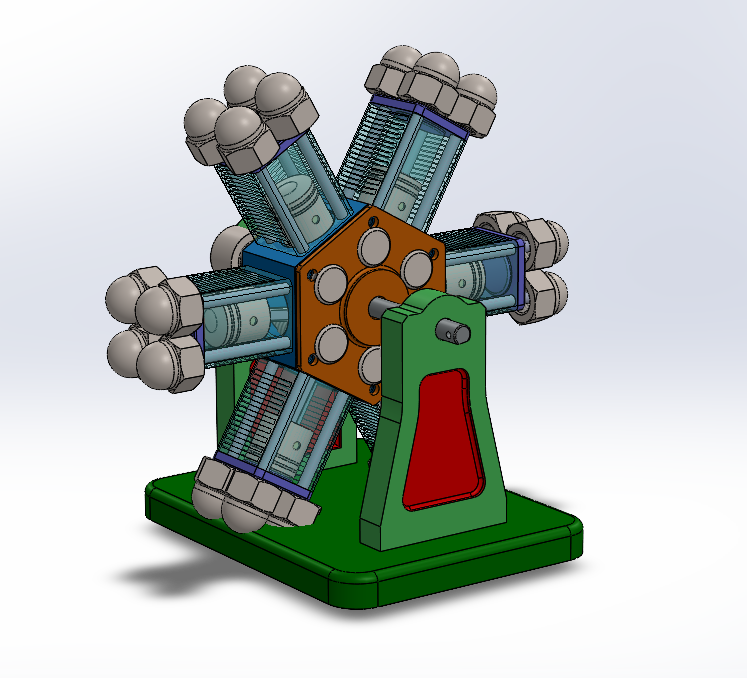
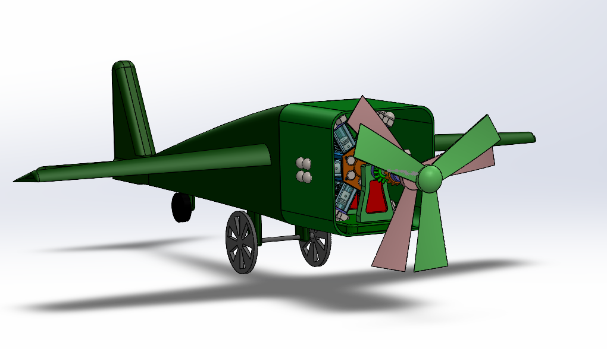
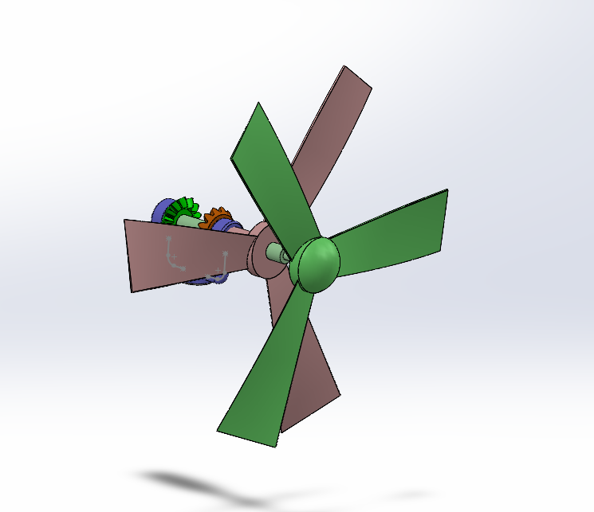

# Six-Cylinder Radial Engine and Aircraft Assembly

**3D CAD Modeling | Mechanical Assembly Design | SolidWorks Animation**

An academic mechanical engineering team project focused on the three-dimensional modeling, assembly, and visualization of a six-cylinder radial engine and aircraft using SolidWorks.

## Project Overview

This project demonstrates the development of individual mechanical components and their integration into a complete radial engine and aircraft assembly. SolidWorks was used for part modeling, assembly development, and visual presentation of the completed models.

## Project Objectives

- Develop three-dimensional CAD models of the engine and associated components.
- Assemble individual components into a six-cylinder radial engine.
- Develop an aircraft assembly incorporating the modeled engine.
- Produce rendered images and animations to demonstrate the completed designs.
- Document the modeling and assembly process.

## Design Gallery

### Radial Engine Assembly

### Aircraft Assembly

### Propeller Assembly

## Project Animation

The following video presents the radial engine, aircraft, and propeller assemblies.

**[Watch SolidWorks Project Animation on YouTube](https://youtu.be/nfhkMRqAlxc)**

## CAD Design Files

The complete SolidWorks project files are available for download.

**[Download SolidWorks CAD Files](6%20Cylinder%20Radial%20Engine%20Plane.zip)**

*SolidWorks is required to open and edit the native CAD files.*

## Technical Report

The project report contains the design documentation and supporting technical details.

**[View Project Report](Report.pdf)**

## Software and Skills

- SolidWorks
- 3D Part Modeling
- Mechanical Assembly Design
- CAD Visualization
- Engineering Documentation

## Project Information

**Project Type:** Academic Team Project  
**Course:** ME-260  
**Institution:** Military Institute of Science and Technology (MIST)

## Team Contribution

The project involved collaborative CAD modeling, subassembly development, complete assembly integration, and design documentation.

## Repository Contents

- `6 Cylinder Radial Engine Plane.zip` — Complete SolidWorks CAD files
- `Engine.png` — Radial engine render
- `Plane.png` — Aircraft render
- `Rotor.png` — Propeller render
- `Report.pdf` — Technical project report
- `README.md` — Project documentation
